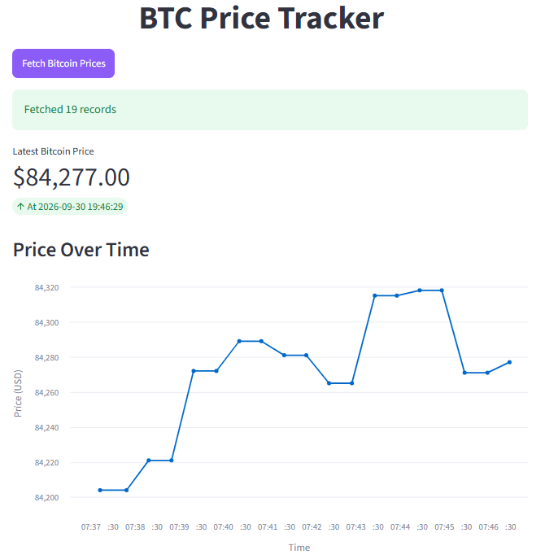

# BTC Price Tracker

End-to-end cryptocurrency price tracking system: **API → SQL Server → Streamlit UI + Docker**

## Architecture

```
┌──────────────┐     ┌──────────────┐     ┌──────────────┐
│  CoinGecko    ────▶  SQL Server   ────▶   Streamlit   │
│     API      │     │   Database   │     │    Web UI    │
└──────────────┘     └──────────────┘     └──────────────┘
```

**Data Flow:**

- **CoinGecko API** → **datacollector** → **SQL Server** (write: inserts BTC price every 30s)
- **SQL Server** → **Streamlit Web UI** (read: queries Bitcoin table on button click)

## Services

| Service         | Description                                            | Port                           |
| --------------- | ------------------------------------------------------ | ------------------------------ |
| `sqlServer`     | Microsoft SQL Server 2019                              | 1434 (host) → 1433 (container) |
| `datacollector` | Fetches BTC price from CoinGecko, stores in SQL Server | —                              |
| `webinterface`  | Streamlit dashboard for visualization                  | 8501                           |

## Quick Start

### Prerequisites

- Docker & Docker Compose

### Run the Project

```bash
# Copy example env file and set your password
cp .env.example .env
# Edit .env and set SA_PASSWORD

docker-compose up --build -d
```

### Access the Web UI

Open your browser at: **http://localhost:8501**

Click **"Fetch Bitcoin Prices"** to load and visualize the data.

## Demo



## Connect to SQL Server from Host

You can connect directly to the database using any SQL client (Azure Data Studio, SSMS, DBeaver, etc.):

| Parameter       | Value                                          |
| --------------- | ---------------------------------------------- |
| **Server name** | `localhost,1434`                               |
| **Login**       | `sa`                                           |
| **Password**    | _Value of `SA_PASSWORD` from your `.env` file_ |
| **Database**    | `Cryptocurrency`                               |

## Database Schema

The `datacollector` service automatically creates:

```sql
CREATE DATABASE Cryptocurrency;

CREATE TABLE Bitcoin (
    DateTime datetime NOT NULL DEFAULT GETUTCDATE(),
    Price decimal(18, 8) NOT NULL
);
```

- **DateTime**: Stored in Pacific Time (converted from UTC)
- **Price**: BTC price in USD
- **Insert frequency**: Every 30 seconds

## Project Structure

```
BTC_Price_Tracker/
├── docker-compose.yaml       # Orchestrates all services
├── .dockerignore             # Excludes unnecessary files from Docker builds
├── .gitignore                # Excludes cache, env, IDE files from git
├── datacollector/
│   ├── Dockerfile            # Python + ODBC driver for SQL Server
│   ├── requirements.txt      # requests, pyodbc
│   └── dataCollector.py      # Fetches BTC price, writes to SQL Server
└── webinterface/
    ├── Dockerfile            # Python + ODBC driver + Streamlit
    ├── requirements.txt      # pyodbc, streamlit, pandas, altair
    └── sqlToWeb.py           # Streamlit app: reads DB, shows charts
```

## Stopping the Project

```bash
docker-compose down
```

To remove volumes (database data):

```bash
docker-compose down -v
```

## Logs

View service logs:

```bash
# All services
docker-compose logs -f

# Specific service
docker-compose logs -f datacollector
docker-compose logs -f webinterface
docker-compose logs -f sqlServer
```

## Configuration

### Environment Variables

Create a `.env` file from the example:

```bash
cp .env.example .env
```

Edit `.env` and set a strong password:

```env
SA_PASSWORD=your_strong_password_here
```

This single variable is used by:

- **SQL Server** (`MSSQL_SA_PASSWORD`) - sets the `sa` account password
- **datacollector** (`SQL_PASSWORD`) - connects to write price data
- **webinterface** (`SQL_PASSWORD`) - connects to read price data

The `docker-compose.yaml` references `${SA_PASSWORD}` and passes it to all three services.

## Notes

- The `datacollector` waits ~19 seconds on startup for SQL Server to be ready
- CoinGecko API has rate limits (429 responses are handled with 60s backoff)
- Data persists in the `sql-volume` Docker volume across restarts
- The web UI uses Altair for interactive charts with proper y-axis scaling

If you like this project, please give it a ⭐️!
